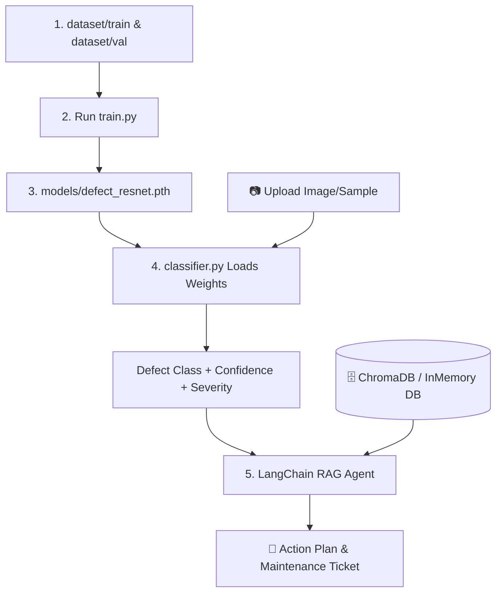

# 🔧 Autonomous Defect Inspector & Maintenance Planner (Multimodal AI)

This is a multimodal industrial AI application that combines a **supervised PyTorch Deep Learning Classifier (CNN)** with a **Generative AI Agent (LangChain RAG)** to inspect industrial surfaces and generate safety/repair plans automatically.

Rather than a simple mock pipeline, this project features a complete **Deep Learning workflow** (generating image matrices, training a ResNet18 model using Transfer Learning, saving state weights, and loading checkpoints for live inference) coupled with semantic search over a local **Vector Knowledge Base**.

---

## 🏗️ System Architecture



---

## 🚀 Key Technical Features

1.  **PyTorch Transfer Learning (`train.py`):** Loads a pre-trained **ResNet18** model, freezes convolutional feature-extractor layers, swaps the classification head (`model.fc = nn.Linear(512, 4)`), and trains the final linear layer on a custom dataset split.
2.  **Dataset Generation (`src/generate_dataset.py`):** Programmatically constructs a structured folder dataset containing 160 images (cracks, rust spots, metallic scratch wear, and normal surfaces) utilizing Pillow (`PIL`) to enable offline training on any machine.
3.  **Local Vector Store RAG (`src/kb_indexer.py`):** Indexes detailed OSHA safety guidelines and corrosion manuals into a local Python vector store (`InMemoryVectorStore`), saving the database as `models/vector_store.pkl` using local `HuggingFaceEmbeddings`.
4.  **Dual Inference Model (`src/classifier.py`):** Loads saved state checkpoints (`defect_resnet.pth`) for deep learning predictions. If weights are missing, it features a fallback rule-based visual feature analyzer (color mask + edge-detection convolutions) to keep the app operational.
5.  **Reactive Split UI (`app.py`):** Built with Streamlit, enabling users to upload equipment photos or choose validation samples. Shows real-time classification statistics, severity ratings, and RAG-generated maintenance plans side-by-side.

---

## 📦 Directory Structure

```
defect_inspector_suite/
├── dataset/            # Programmatically generated images (train & val splits)
├── models/             # PyTorch defect_resnet.pth and vector_store.pkl database
├── src/
│   ├── generate_dataset.py   # Dataset creator script
│   ├── classifier.py         # PyTorch inference engine (ResNet18)
│   ├── kb_indexer.py         # Vector store creator & manual indexer
│   └── agent.py              # LangChain RAG pipeline
├── app.py              # Streamlit dashboard web interface
├── train.py            # PyTorch model trainer script
├── requirements.txt    # Project dependencies
├── .env                # API Keys
└── README.md           # Documentation & resume summary
```

---

## ⚙️ How to Setup & Run

### 1. Configure API Key
Create a `.env` file containing your Groq API key:
```env
GROQ_API_KEY=your-groq-api-key-here
```

### 2. Build the Vector Store
Execute the indexer script to index the guidelines:
```powershell
.\venv\Scripts\python.exe src/kb_indexer.py
```

### 3. Run the Dashboard
Start the Streamlit dashboard in your terminal:
```powershell
.\venv\Scripts\python.exe -m streamlit run app.py
```
Open **[http://localhost:8501](http://localhost:8501)** in your browser, upload an image or choose one of the pre-loaded validation samples, and watch the visual classifier and RAG agent collaborate in real-time!

---


> **Multimodal AI Defect Inspector & Maintenance Planner** | *PyTorch, LangChain, Llama 3.3, ChromaDB/VectorStore, Streamlit*
> *   **Engineered an end-to-end multimodal pipeline** combining a **supervised PyTorch CNN** (ResNet18) for image classification with a **LangChain RAG agent** for automated reporting and maintenance ticketing.
> *   **Built a PyTorch Transfer Learning pipeline** that freezes pre-trained ResNet18 convolutional layers, replaces the classification head with a custom linear layer, and trains the model on custom visual defect categories (cracks, rust, wear).
> *   **Developed a local Vector Store (InMemory RAG)** containing safety manuals, implementing semantic searches via **HuggingFace Embeddings** to retrieve context and prevent model hallucinations.
> *   **Constructed a visual frontend** using **Streamlit** that handles image uploads, displays CNN confidence statistics and severity ratings, and renders markdown maintenance plans side-by-side.
